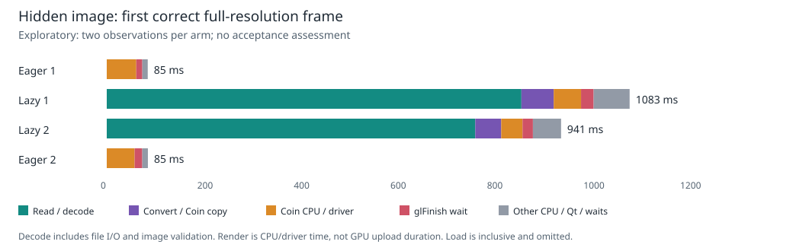

# T004.2 P07 diagnostic results

Date: 2026-11-08. **Complete exploratory diagnostic; not acceptance.**
All 16 corrected workers passed the full model, image, calibration, frame,
native-profile, lifecycle and runtime identity checks. Both 39,985-binding audits
passed; no retries, replacements, exclusions or pooling occurred. Each context has
only two observations per arm, so the values below are descriptive medians, not
D001 decisions or reliable tail estimates.

## Finding: first-show cost is mainly image read/decode

| Hidden-image workflow | Eager | Retained lazy |
| --- | ---: | ---: |
| Open to first correct frame | 4,094 ms | 2,071 ms |
| First show to full-resolution correct frame | 85 ms | 1,012 ms |
| Open plus first show | 4,179 ms | 3,082 ms |
| Repeat show | 4.98 ms | 5.61 ms |
| Timed-window peak process RSS | 931.93 MiB | 844.55 MiB |
| Peak logical Coin image storage | 280.04 MiB | 186.69 MiB |

The two lazy first-show observations were 1,082.74 and 940.78 ms. Their median
breakdown is approximately 811 ms read/decode, 60 ms conversion/Coin copy,
50 ms Coin rendering/driver calls, 24 ms final `glFinish` wait and 66 ms other
CPU/Qt/events/waits. Read/decode accounts for about 80% of the observed delay.
It includes file access, format/extent validation and SVG/raster loading; it is
not a decoder-only CPU measurement. Rendering is CPU/driver elapsed time;
`glFinish` measures the remaining completion wait, not total GPU upload time.

Native load spans include decode/conversion and are **not** added to them. The
plotted component spans do not overlap in these observations. The residual is
unattributed; it must not be relabeled as pure host scheduling. Open rendering
before observer registration is outside the native render counter's coverage.

The resource benefit remains visible: lazy loading avoids materializing two
unshown images during the measured window. Its process RSS peak is about 87 MiB
lower and its logical Coin peak about 93 MiB lower. The decoded-image peak remains
93.35 MiB in both arms. These are process/logical-storage observations, not GPU
residency. Work for an image that is eventually shown is deferred; unshown-image
work is avoided within this window.

## Controls and host load

| Open to correct frame | Eager median | Lazy median |
| --- | ---: | ---: |
| All images visible | 4,836 ms | 6,188 ms |
| PartDesign control | 276 ms | 379 ms |
| VRML control | 585 ms | 666 ms |

These small control sets are variable and do not support acceptance. All-visible
images follow the same materialization behavior in both arms; the image-plane
visibility condition has no image-plane work in the two controls. Their slower
observations therefore do not demonstrate that lazy loading caused the increase.
The full raw observations remain available; none were discarded.

Telemetry captured 198 one-second samples, starting 30 seconds before the
controller, with no missed-interval events or unavailable sources. One-minute
host load ranged from 3.44 to 7.75. The collector itself used a median 28.6 ms CPU
per sample, with a 112.5 ms maximum. This observer cost is material for short
operations and must be reduced or explicitly qualified before acceptance work.
One-second sampling cannot resolve the cause of each subsecond phase.

This was an observed desktop, not a dedicated idle host. The trace is useful
context but does **not** establish the cause of the earlier BIM P01 p95 result:
that BIM comparison was not rerun here. Whole-worker sampled RSS includes later
fidelity checks and is not interchangeable with the timed-window peak above.

## Provenance correction and retained attempts

The earlier 16-worker diagnostic stopped at its first eager worker with a runtime
receipt mismatch. Its zero qualified rows, host trace, failure output and successful
39,964-binding post-abort audit remain intact; its other 15 workers were not run.
A separate fixed two-process forensic qualification preserved the module difference:
both arms had the same two additional mapped Qt resources, `Mod/BIM/Arch_rc.rcc`
and `Mod/Draft/Draft_rc.rcc`. All original 14 native mappings matched; no missing
or changed mapping was found. Both resource hashes matched the full qualified
build inventory. BIM/Draft register these resources at startup, and the retained
P01 build included them while the older T020 context did not.

The corrected context pins the exact 16 mapped files. Exact equality remains
required; no library/resource is ignored. The two forensic processes supply no
accepted or reported timing values. The corrected run is a new independent
campaign under [its recorded correction plan](t004-p07-corrected-diagnostic-plan.md).

The separate earlier telemetry launch failure also remains archived: Pixi Python
lacks the required pidfd APIs and no GUI worker or baseline sample started there.
The selected host Python is isolated with `-I -S -B`, actual pidfd capability is
checked before session creation, and its module/native closure is hash-bound.
Native FreeCAD workers retain locked Pixi Python. Both clocks use CLOCK_MONOTONIC.

Both optimized builds passed the final 408 focused native cases, including trace
nesting/overflow, conversion pixels/storage, rendered fidelity, calibration,
restore/import/save/reopen and included-file failure behavior. The initial eager
lifecycle harness-mode failure and build namespace/cache preparation failures
remain preserved. Shared generated Qt translation inputs were normalized only
after proving the complete generated sources differ solely in resource timestamps;
both arms were independently recompiled with ccache disabled. All common App/Gui
objects then matched except the intended image-plane provider object.

## Disposition and next work

Retain P07 as agreed. The benefit is faster hidden opening and lower memory; the
first full-resolution show pays the deferred read/decode cost. This evidence does
not select speculative asynchronous loading, lower-resolution placeholders or
calibration changes. Conversion alone is a small part of this first-show delay.

P01 and P07 remain unaccepted under the original D001 criteria. No budget, old
sample, protocol or assessor changed. T004.2 remains in progress: complete the
P04 direct and P05 fallback comparative evidence next. Before a future P07
acceptance campaign, record an exact source/measurement-condition correction,
qualify observer cost and runtime applicability, and select the new freeze/plan.
A change to first-show criteria remains a separate explicit product decision.

Machine results: [t004-p07-diagnostic-results.json](t004-p07-diagnostic-results.json).
Sanitized evidence: [manifest](t004-p07-diagnostic-evidence/evidence-manifest.json).
Raw timelines, process IDs, host traces and private fixture locators remain in
protected local artifact directories. No private images or model values are published.
The existing 6.4 GiB build pair was reused; no additional full build pair or
per-arm compiler-cache copies were created.
